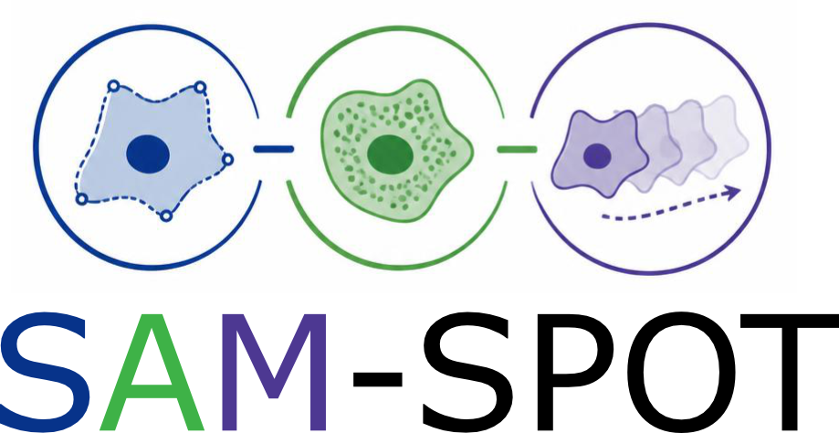

# SAM-SPOT GUI

<p align="center"></p>

A point-and-click interface to run the full SPOT workflow on a folder of organoid videos and look at the results, without writing code. It follows the reference analysis scripts in `data/full_dataset_with_biomarker/reference_analysis_scripts` (Stage 1, Stage 2 and the Stage 3 analysis, without p-Creode), using SPOT 2.0 defaults.

## Start

Install SPOT first (see the main [README](../README.md#to-install)), then:

```shell
conda activate SAM-SPOT_env
python gui/spot_gui.py
```

On Windows you can also double-click `gui/launch_spot_gui.bat`; edit `SPOT_ENV` in it if your conda environment has another name. The GUI uses the SPOT code of this repository when SPOT is not installed with pip.

## Workflow

| tab | what to do |
|---|---|
| **1. Set up** | Choose what to analyse (videos, or a [Cell Tracking Challenge dataset](#cell-tracking-challenge-datasets)), the videos folder and an (empty) results folder, enter the pixel size and the time between frames. Tick *matching fluorescent marker video* if every brightfield video `<name> BF.AVI` has a marker video `<name>.AVI`. Click **Find videos** and tick the videos to analyse. |
| **2. Sample info** | Give each video its condition (e.g. drug), and optionally genotype, patient / batch and marker. **Guess from video names** fills them from names like `C10 6 µM Cisplatin Cytotox 2` (well and replicate dropped). Check, then **Save sample table**. |
| **3. Run pipeline** | Tick the steps and click **Run**. The table shows the progress of every video; the log shows details and errors. A run can be stopped; with *Skip steps already completed* ticked, the next run continues where it stopped. |
| **4. Check segmentation** | Step through the frames of each video with the detected boxes, raw segmentation or final organoid outlines drawn on top. |
| **5. Analysis & results** | Choose how to group the organoids (e.g. by condition) and click **Run analysis**. Browse the figures; double-click opens a figure or table in its own program. |

Tip: run 2 - 3 videos through Stage 1 first, check the outlines on tab 4, adjust *Advanced settings* if needed, then run all videos.

A step-by-step tutorial with screenshots is in [SAM-SPOT_GUI_tutorial.pdf](SAM-SPOT_GUI_tutorial.pdf).

## Cell Tracking Challenge datasets

Under *What to analyse* on tab 1, choose **Cell Tracking Challenge dataset** to analyse annotated cell videos from [celltrackingchallenge.net](http://celltrackingchallenge.net) (e.g. `PhC-C2DH-U373`), or the results of your own segmentation / tracking saved in the challenge format. Choose the dataset folder (with `01`, `01_GT`, `01_ST`, ...) or a folder holding several datasets; every sequence (`01`, `02`, ...) is analysed like a video, named `<dataset>-<sequence>`.

- The cells and their tracks come from the annotations, so *Detect*, *Track* and *Segment* are skipped. *Prepare* reads the frames `t000.tif, ...` as they are (no resizing or drift correction, so they stay aligned with the masks; 16-bit images are scaled to 8 bit).
- *Outlines* (the *Clean up* step) outlines every cell of every track, removes cells touching the image border (*Border width / fraction* in Advanced settings) and tracks shorter than *Min. track length*. A track ends at a cell division; the daughters are new tracks, as in the challenge format.
- *Cell outlines from*: **Best annotation** uses for each tracked cell the silver truth segmentation (`<seq>_ST/SEG`), else the gold truth segmentation (`<seq>_GT/SEG`), else the gold truth tracking marker (`<seq>_GT/TRA`), matching the segmentation regions to the tracks by overlap; **Gold truth tracking markers only** uses `<seq>_GT/TRA`; **My results** uses `<seq>_RES/mask###.tif` and `res_track.txt`.
- Enter the pixel size and time between frames of the dataset (e.g. PhC-C2DH-U373: 0.65 µm, 15 min = 0.25 h). The SAM phenome, compilation and analysis are the same as for organoids.

## Themes

The **Theme** menu (top right) switches the colours of the window between *Standard* (the system look), *Pink Panther* and *Forest Green*. The choice is remembered.

## Steps

| stage | step | output (in the results folder) |
|---|---|---|
| 1 | Prepare: grayscale, resize to 512 x 512, drift correction | `videos/<name>/<name>_register.tif` (+ `_marker_register.tif`) |
| 1 | Detect organoids (pretrained YOLOv3, PyTorch) | `videos/<name>/bbox_detection/` |
| 1 | Track organoids (optical flow) | `.../flow_bbox_tracks_Ch-1.mat` |
| 1 | Segment outlines (pretrained attention U-Net) | `.../organoid_segmentation/org_boundaries-Channel-1.mat` |
| 1 | Clean up tracks (filter, smooth, split, remove border organoids) | `.../<name>_boundaries_final_RGB.mat` |
| 2 | SAM phenome: shape, appearance, motion features | `.../<name>_final_cont_RGB_{shape,image,motion}-feats.mat` |
| 2 | Marker: mean intensity, number and intensity of spots in each organoid | `.../<name>_final_cont_RGB_additional-feats.mat` |
| 2 | Compile the dataset | `<dataset>_{shape,image,motion,marker}_features.csv`, boundaries and image patches `.mat` |
| 3 | Analysis | `analysis/<analysis name>/` |

The analysis normalises the features (curvature scaling, removal of constant / extreme features, kernel reduction of the ECT, standard scaling + power transform, selection of time-varying features), optionally regresses out the batch, weights shape, appearance and motion equally, then computes

- `00_feature_overview`: contribution of the shape, appearance and motion sets;
- `01_SAM_modules`: SAM modules (multi-scale selection), their feature contributions and most representative organoids;
- `02_phenotype_map`: UMAP (or PaCMAP) of all organoid instances, with organoid images, groups, time and key features;
- `03_condition_density`: density of each group on the map;
- `04_phenotype_clusters`: K-means phenotype clusters (ordered by elongation), representative organoids, module signature, proportions per group;
- `05_time_course`: cluster composition over time per group;
- `06_phenotype_trajectories`: average phenotype trajectory per group and their similarity (DTW);
- `07_phenotype_transitions`: hidden Markov model transition matrix, graph and entropy per group;
- `08_markers`: marker measurements on the map and per group / cluster (paired marker videos only);
- `organoid_phenotypes.csv`: one row per organoid and time point with its sample information, map coordinates, cluster, module scores and marker values; `normalised_SAM_features.csv`.

## Reproducibility

Every setting is saved, so a run can be reloaded and repeated exactly:

- `spot_project.json` (results folder): the current settings of the project. **Open project...** reopens it.
- `run_history/<date-time>/` (one folder per run): `run_config.json` with the complete settings, the steps and videos run, the versions of SPOT (with the git commit), Python, the main packages, the GPU and the sha256 of the network weights, and the outcome per video; `sample_info.csv`, the sample table used; `log.txt`, the full log. **Run history...** on the "Run pipeline" tab opens it.
- `videos/<name>/params/<step>.json`: the settings each step of each video was computed with (including those of the steps before it).
- `<dataset>_compile_params.json` and `analysis/<name>/analysis_config.json` (+ `sample_info_used.csv`): the same for the compiled tables and each analysis.

**Load settings...** (top right) takes any of `spot_project.json`, `run_config.json` or `analysis_config.json`, either reopening its folders or applying the settings to the current project, and can restore the sample table saved with it. On the "Run pipeline" tab, ⟳ *changed* marks results computed with settings different from the current ones (also when an earlier step changed); they are recomputed on the next run, even with *Skip steps already completed* ticked. The networks, UMAP and clustering use fixed random seeds.

## Command line

The GUI saves the settings as `spot_project.json` in the results folder. The same pipeline can be run without the GUI, e.g. on a server:

```shell
python gui/spot_pipeline.py --config <results folder>/spot_project.json --steps prepare,detect,track,segment,postprocess,features,markers,compile,analysis
```

`--config` also accepts a `run_history/<date-time>/run_config.json`, to repeat that run (its `command` entry gives the full command line).
